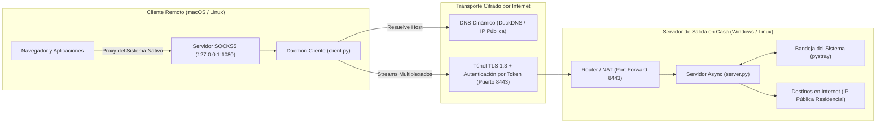

<div align="center">

# 🔒 HomeVPN: Túnel Asíncrono SOCKS5 sobre TLS

[](https://www.python.org/downloads/)
[](https://opensource.org/licenses/MIT)
[]()
[]()

<br />

🌐 **Language / Idioma:** [English](README.md) • **Español**

<br />

**Un túnel VPN/Proxy multiplataforma, liviano y de alto rendimiento implementado en Python puro con I/O asíncrono y cifrado TLS.**

*Enruta todo el tráfico de tus aplicaciones y sistema operativo desde una notebook remota a través de una PC en tu casa para navegar por Internet con tu IP residencial.*

[Características](#-características-principales) • [Arquitectura](#-arquitectura) • [Primeros Pasos](#-primeros-pasos) • [Cliente macOS](#-configuración-del-cliente-macos) • [Servidor Windows](#-configuración-del-servidor-windows) • [Seguridad](#-seguridad-y-decisiones-de-diseño)

</div>

---

## 💡 Visión General

Las soluciones tradicionales de VPN en Capa 3 (como OpenVPN o WireGuard) exigen permisos de administrador, drivers de red a nivel de kernel (`wintun`, `utun`) y complejas manipulaciones de tablas de enrutamiento.

**HomeVPN** es un túnel a nivel de transporte en espacio de usuario (*userspace*) que aprovecha el protocolo **SOCKS5 (RFC 1928)** encapsulado sobre una conexión segura **TLS 1.2/1.3**. Ofrece:
- Enrutamiento completo de aplicaciones y del sistema sin requerir drivers de kernel.
- Resistencia total a la Inspección Profunda de Paquetes (DPI), ya que el tráfico es indistinguible de conexiones web HTTPS normales.
- Cero dependencias externas complejas, utilizando primitivas estándar de red en Python (`asyncio`, `ssl`, `socket`).

---

## 🏛️ Arquitectura



---

## ✨ Características Principales

- **Núcleo Asíncrono de Alto Rendimiento:** Impulsado por `asyncio` para reenvío de streams bidireccionales no bloqueantes con consumo mínimo de CPU y memoria.
- **Seguridad Criptográfica:** Cifrado de extremo a extremo con TLS 1.2/1.3, certificados X.509 propios y autenticación inicial por token secreto precompartido.
- **Protocolo SOCKS5 (RFC 1928):** Servidor proxy local que soporta direccionamiento IPv4, IPv6 y resolución remota de dominios DNS (evitando fugas o *DNS leaks* de tu ISP local).
- **Automatización de Red en macOS:** Configuración y restauración automática e instantánea del proxy del sistema mediante la herramienta nativa `networksetup`.
- **Aplicación para la Bandeja de Windows:** Interfaz gráfica ligera en la barra de tareas (*System Tray*) creada con `pystray` y `Pillow`, con métricas y estado en tiempo real.
- **Sincronización con DNS Dinámico (DDNS):** Proceso en segundo plano integrado para actualizar cambios de IP automáticamente en DuckDNS.
- **Sin Drivers de Kernel:** Corre completamente en espacio de usuario; no requiere permisos de `sudo`/root en el cliente.

---

## 📂 Estructura del Proyecto

```text
VPN-OpenSource/
├── .github/workflows/
│   └── python-app.yml         # CI automático de sintaxis y compatibilidad
├── certs/
│   ├── generate_certs.py      # Generador automatizado de certificados TLS
│   └── README.md
├── common/
│   ├── __init__.py
│   └── protocol.py            # Protocolo de framing y piping asíncrono
├── server/
│   ├── __init__.py
│   ├── server.py              # Servidor asíncrono TLS
│   ├── tray.py                # Interfaz gráfica para la bandeja de Windows
│   ├── ddns.py                # Actualizador de DNS Dinámico
│   ├── config.example.json    # Plantilla de configuración del servidor
│   └── start_server.bat       # Acceso rápido en Windows
├── client/
│   ├── __init__.py
│   ├── client.py              # CLI y cliente del túnel SOCKS5
│   ├── macos_proxy.py         # Módulo de automatización networksetup en macOS
│   └── config.example.json    # Plantilla de configuración del cliente
├── requirements.txt           # Dependencias mínimas
├── LICENSE                    # Licencia MIT
├── README.md                  # Documentación principal en Inglés
└── README.es.md               # Documentación en Español
```

---

## 🚀 Primeros Pasos

### 1. Clonar el Repositorio e Instalar Dependencias

```bash
git clone https://github.com/tu-usuario/home-vpn-tunnel.git
cd home-vpn-tunnel

python3 -m pip install -r requirements.txt
```

### 2. Generar Certificados TLS

Ejecuta el script generador para crear `server.crt` y `server.key`:

```bash
python3 certs/generate_certs.py
```

*(Nota: el archivo `.gitignore` está configurado para que la clave privada `server.key` y el certificado nunca se suban a Git).*

---

## 🖥️ Configuración del Servidor (PC de Escritorio / Gateway)

### 1. Configuración (`server/config.json`)

Copia `server/config.example.json` a `server/config.json`:

```json
{
  "listen_host": "0.0.0.0",
  "listen_port": 8443,
  "auth_token": "GENERA_UN_TOKEN_SECRETO_AQUI",
  "cert_file": "../certs/server.crt",
  "key_file": "../certs/server.key",
  "duckdns": {
    "enabled": false,
    "domain": "tu-subdominio.duckdns.org",
    "token": "tu-token-duckdns",
    "interval_seconds": 600
  }
}
```

### 2. Reenvío de Puertos (Port Forwarding) y Firewall
- Abre el puerto TCP **8443** en tu router apuntando a la IP local de tu PC de escritorio.
- Permite el puerto 8443 en el Firewall de Windows:
  ```powershell
  netsh advfirewall firewall add rule name="HomeVPN" dir=in action=allow protocol=TCP localport=8443
  ```

### 3. Iniciar el Servidor
```bash
python server/server.py
# O iniciar con la interfaz en la bandeja del sistema:
python server/tray.py
```

---

## 💻 Configuración del Cliente (macOS Remoto)

### 1. Configuración (`client/config.json`)

Copia `client/config.example.json` a `client/config.json`:

```json
{
  "server_host": "TU_IP_PUBLICA_O_DOMINIO_DE_CASA",
  "server_port": 8443,
  "auth_token": "EL_MISMO_TOKEN_DEL_SERVIDOR",
  "local_socks_host": "127.0.0.1",
  "local_socks_port": 1080,
  "auto_configure_macos_proxy": true,
  "verify_ssl": false
}
```

### 2. Comandos de Uso

- **Probar Conectividad y Latencia:**
  ```bash
  python3 client/client.py test
  ```
- **Conectar Túnel y Activar Proxy del Sistema:**
  ```bash
  python3 client/client.py connect
  ```
  *(Presiona `Ctrl + C` en cualquier momento para desconectarte y restaurar la red normal de tu Mac al instante).*

- **Verificar Estado del Proxy e IP Pública:**
  ```bash
  python3 client/client.py status
  ```

- **Desconectar Proxy Manualmente:**
  ```bash
  python3 client/client.py disconnect
  ```

---

## 🛡️ Seguridad y Decisiones de Diseño

| Riesgo / Requerimiento | Estrategia de Mitigación |
|---|---|
| **Ataques Man-in-the-Middle (MitM)** | Cifrado forzado TLS 1.2+ con algoritmos modernos (AES-256-GCM / ChaCha20) y firmas SHA-256. |
| **Acceso no autorizado / Relay abierto** | Handshake con validación estricta de token secreto antes de habilitar el túnel TCP. |
| **Fugas de DNS (DNS Leaks)** | SOCKS5 `ATYP 0x03` delega la resolución de nombres de dominio al servidor remoto de casa, evitando el monitoreo del ISP local de la red pública. |
| **Inspección Profunda de Paquetes (DPI)** | Los datos se encapsulan en registros TLS estándar, haciendo el tráfico indistinguible del tráfico HTTPS de navegación web común. |

---

## 📄 Licencia

Este proyecto está bajo la **Licencia MIT** — consulta el archivo [LICENSE](LICENSE) para más detalles.
