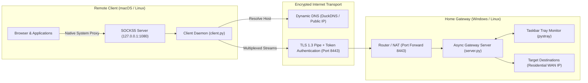

<div align="center">

# 🔒 HomeVPN: Asynchronous SOCKS5-over-TLS Tunnel

[](https://www.python.org/downloads/)
[](https://opensource.org/licenses/MIT)
[]()
[]()

<br />

🌐 **Language / Idioma:** **English** • [Español](README.es.md)

<br />

**A lightweight, high-performance, cross-platform VPN/proxy tunnel implemented in pure Python with asynchronous I/O and TLS encryption.**

*Route entire system or browser traffic from remote clients through a private home gateway to appear on the Internet with your residential IP address.*

[Features](#-key-features) • [Architecture](#-architecture) • [Getting Started](#-getting-started) • [macOS Automation](#-macos-client-setup) • [Windows Gateway](#-windows-gateway-setup) • [Security](#-security--design-decisions)

</div>

---

## 💡 Overview

Traditional Layer 3 VPN solutions (OpenVPN, WireGuard) require administrative privileges, kernel drivers (`wintun`, `utun`), and complex routing table manipulations. 

**HomeVPN** is a userspace transport tunnel leveraging the **RFC 1928 SOCKS5 protocol** layered over an authenticated **TLS 1.2/1.3 stream**. It provides:
- Seamless application & system routing without kernel-level drivers.
- Complete resistance to Deep Packet Inspection (DPI) by disguising traffic as standard HTTPS.
- Zero external runtime dependencies beyond standard Python networking primitives.

---

## 🏛️ Architecture



---

## ✨ Key Features

- **Asynchronous Core:** Powered by Python's `asyncio` for non-blocking bi-directional socket piping with minimal CPU and memory overhead.
- **Cryptographic Security:** End-to-end TLS 1.2/1.3 encryption with custom X.509 certificates and pre-shared secret token handshakes.
- **RFC 1928 SOCKS5 Protocol:** Local SOCKS5 proxy server supporting IPv4, IPv6, and remote DNS domain resolution (preventing ISP DNS leaks).
- **macOS System Proxy Automation:** Seamless auto-configuration and teardown of macOS network interfaces using native `networksetup`.
- **Windows Taskbar Tray Application:** Interactive system tray application built with `pystray` and `Pillow` displaying live connection state and metrics.
- **Dynamic DNS Integration:** Built-in background worker to automatically sync IP changes with DuckDNS.
- **Zero Kernel Drivers:** Runs completely in userspace without requiring root/Administrator permissions on the client.

---

## 📂 Project Structure

```text
VPN-OpenSource/
├── .github/workflows/
│   └── python-app.yml         # CI build & syntax matrix testing
├── certs/
│   ├── generate_certs.py      # Automated self-signed TLS cert generator
│   └── README.md
├── common/
│   ├── __init__.py
│   └── protocol.py            # Custom binary framing & async stream pipes
├── server/
│   ├── __init__.py
│   ├── server.py              # TLS gateway server implementation
│   ├── tray.py                # Windows System Tray GUI application
│   ├── ddns.py                # Dynamic DNS background updater
│   ├── config.example.json    # Gateway configuration template
│   └── start_server.bat       # Quick-launch batch file for Windows
├── client/
│   ├── __init__.py
│   ├── client.py              # SOCKS5 client daemon & CLI interface
│   ├── macos_proxy.py         # macOS networksetup automation module
│   └── config.example.json    # Client configuration template
├── requirements.txt           # Minimal project dependencies
├── LICENSE                    # MIT License
└── README.md
```

---

## 🚀 Getting Started

### 1. Clone & Install Dependencies

```bash
git clone https://github.com/your-username/home-vpn-tunnel.git
cd home-vpn-tunnel

python3 -m pip install -r requirements.txt
```

### 2. Generate TLS Certificates

Run the self-contained generator to create `server.crt` and `server.key`:

```bash
python3 certs/generate_certs.py
```

*(Note: `certs/server.key` and `certs/server.crt` are strictly ignored by `.gitignore` to prevent credential exposure).*

---

## 🖥️ Windows Gateway Setup (Home Exit Node)

### 1. Configure Gateway (`server/config.json`)

Copy `server/config.example.json` to `server/config.json`:

```json
{
  "listen_host": "0.0.0.0",
  "listen_port": 8443,
  "auth_token": "GENERATE_A_SECURE_TOKEN_HERE",
  "cert_file": "../certs/server.crt",
  "key_file": "../certs/server.key",
  "duckdns": {
    "enabled": false,
    "domain": "your-subdomain.duckdns.org",
    "token": "your-duckdns-token",
    "interval_seconds": 600
  }
}
```

### 2. Port Forwarding & Firewall
- Open TCP port **8443** on your home router and direct it to your local machine IP.
- Ensure Windows Defender Firewall allows incoming TCP on port 8443:
  ```powershell
  netsh advfirewall firewall add rule name="HomeVPN" dir=in action=allow protocol=TCP localport=8443
  ```

### 3. Launch the Server
```bash
python server/server.py
# Or launch with System Tray UI:
python server/tray.py
```

---

## 💻 macOS Client Setup (Remote Machine)

### 1. Configure Client (`client/config.json`)

Copy `client/config.example.json` to `client/config.json`:

```json
{
  "server_host": "YOUR_HOME_PUBLIC_IP_OR_DYNAMIC_DOMAIN",
  "server_port": 8443,
  "auth_token": "MATCHING_SERVER_TOKEN",
  "local_socks_host": "127.0.0.1",
  "local_socks_port": 1080,
  "auto_configure_macos_proxy": true,
  "verify_ssl": false
}
```

### 2. Usage Commands

- **Test Connectivity:**
  ```bash
  python3 client/client.py test
  ```
- **Connect Tunnel & Enable System Proxy:**
  ```bash
  python3 client/client.py connect
  ```
  *(Press `Ctrl + C` anytime to cleanly disconnect and restore direct network connectivity).*

- **Inspect Proxy & External IP Status:**
  ```bash
  python3 client/client.py status
  ```

- **Emergency Proxy Disconnect:**
  ```bash
  python3 client/client.py disconnect
  ```

---

## 🛡️ Security & Design Decisions

| Threat / Requirement | Mitigation Strategy |
|---|---|
| **Man-in-the-Middle (MitM)** | Enforced TLS 1.2+ stream encryption with SHA-256 signatures. |
| **Unauthorized Relaying** | Constant-time authentication token handshake verified prior to granting TCP tunnel access. |
| **DNS Leaks** | SOCKS5 `ATYP 0x03` domain resolution defers name resolution to the remote gateway, preventing local ISP tracking. |
| **DPI / Protocol Sniffing** | Tunnel payloads are encapsulated inside valid TLS application records, indistinguishable from standard HTTPS web browsing. |

---

## 📄 License

This project is licensed under the **MIT License** — see the [LICENSE](LICENSE) file for details.
